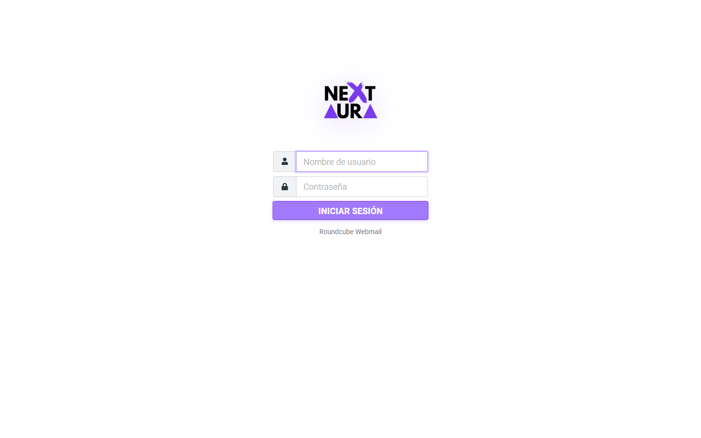
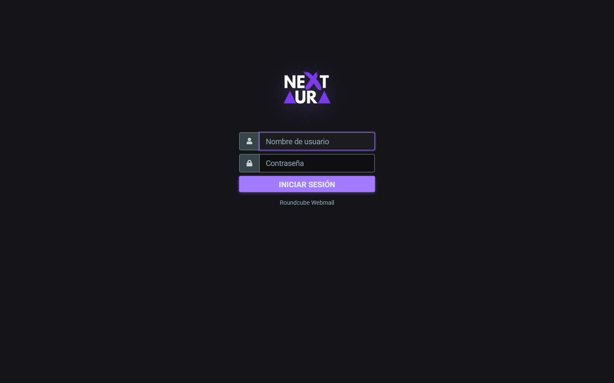
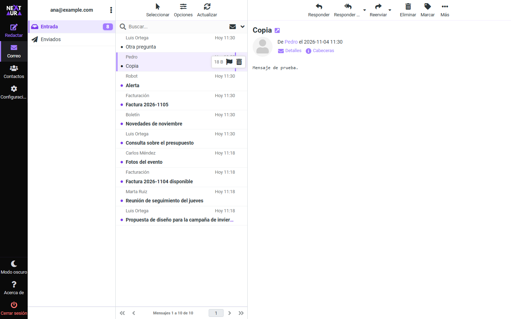
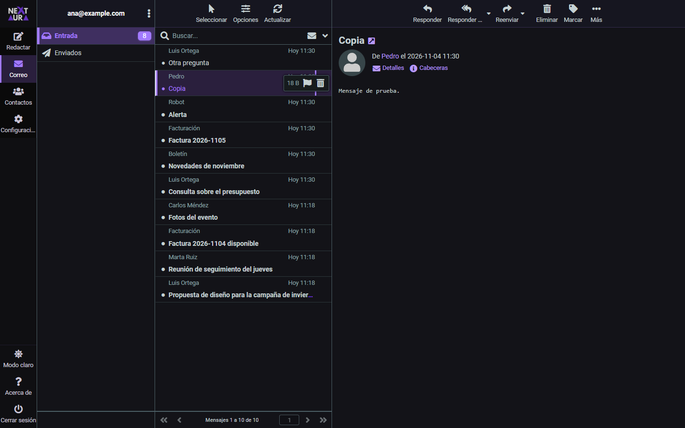
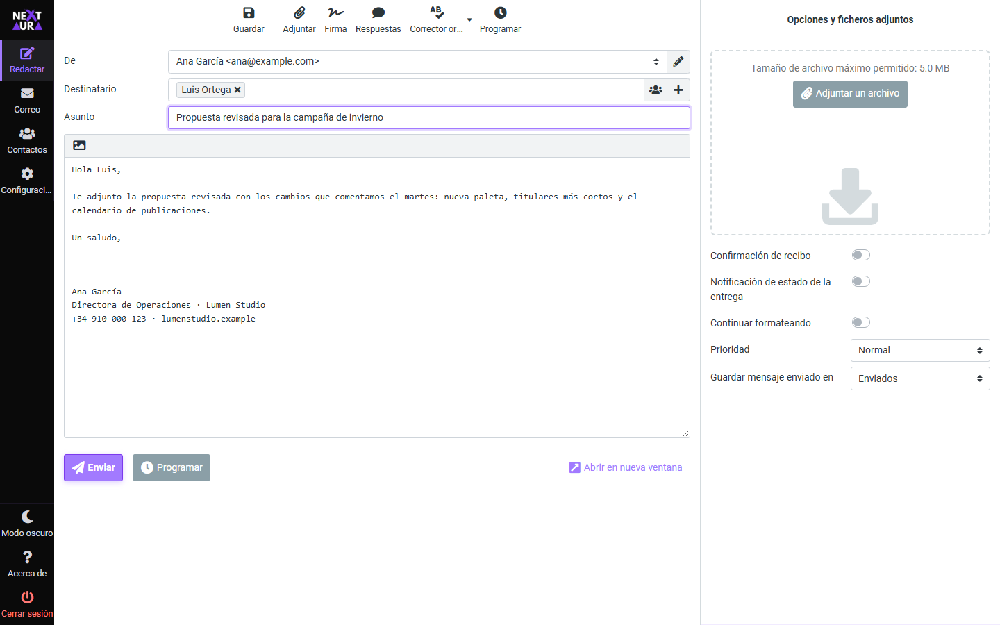
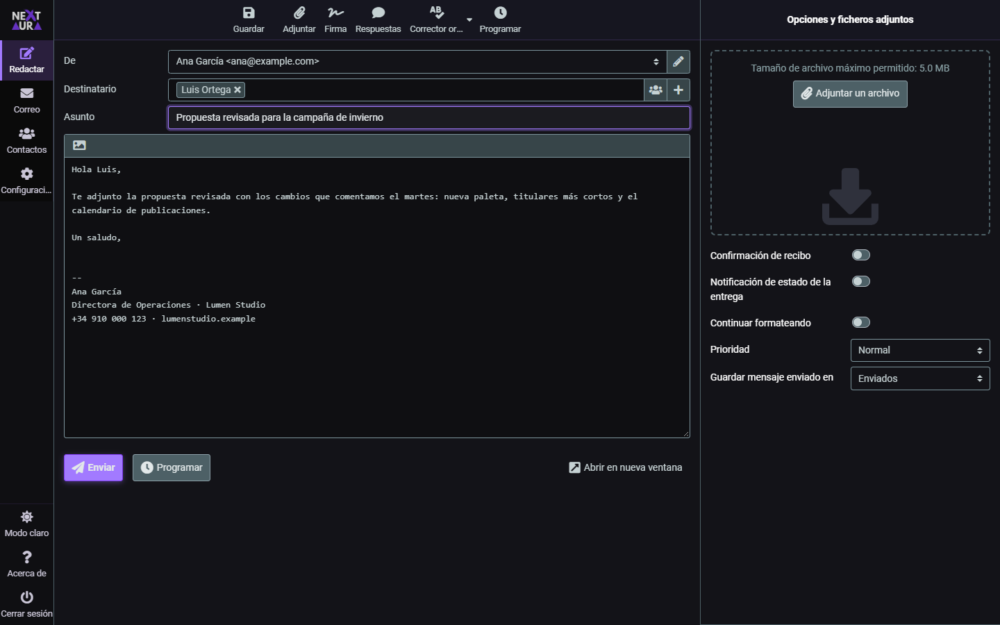
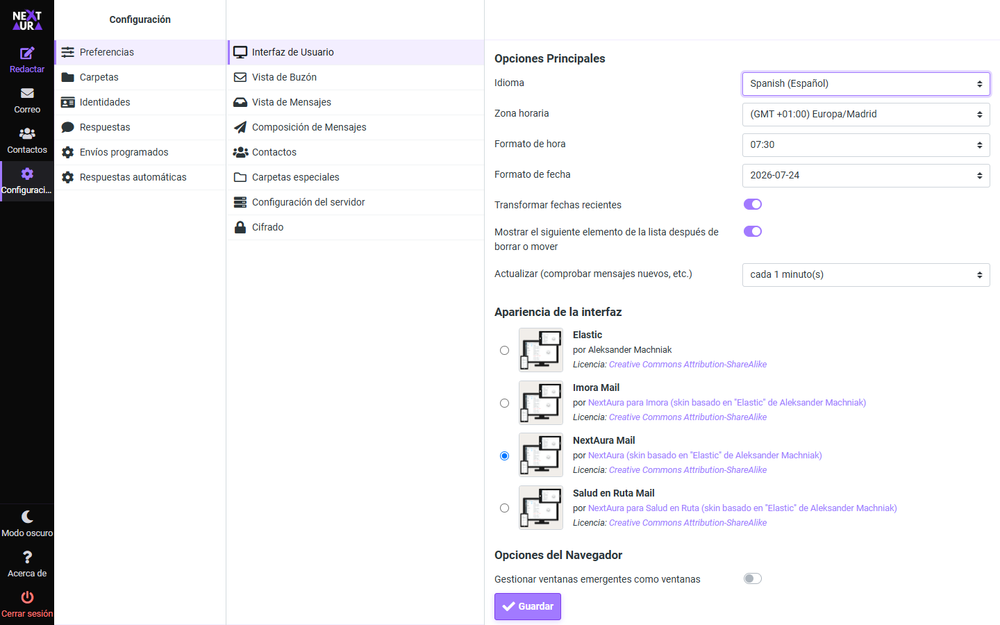
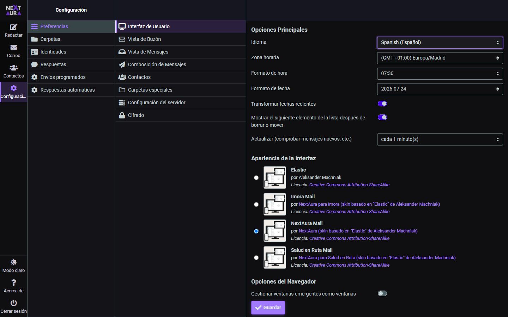

<div align="center">



# NextAura Mail — Roundcube Skin

**Skin oficial de NextAura para Roundcube Webmail.**  
Diseño moderno, modo oscuro nativo, paleta de marca y experiencia pulida lista para producción.

[](http://creativecommons.org/licenses/by-sa/3.0/)
[](https://roundcube.net/)
[](https://github.com/nextaura/nextaura-roundcube)
[](https://github.com/roundcube/roundcubemail/tree/master/skins/elastic)

</div>

---

## Capturas de pantalla

| Modo claro | Modo oscuro |
|---|---|
|  |  |
|  |  |
|  |  |
|  |  |

Hechas con Roundcube 1.7.5 en Docker y correos de ejemplo.

---

## Características

- **Modo oscuro nativo** — soporte completo con `dark_mode_support: true`, logos separados y colores adaptados
- **Paleta de marca NextAura** — morado vibrante `#a27aff`, fondos profundos `#0f0f12`, tipografía Roboto
- **Sin gradientes** — diseño plano y limpio, sin ruido visual
- **Logos por modo** — logo claro/oscuro y versión reducida para cada modo
- **Scrollbars personalizadas** — thumb y track con los colores de marca en ambos modos
- **Responsive** — layouts para desktop, tablet y móvil (widescreen)
- **Hereda de Elastic** — `extends: elastic`: plantillas y JavaScript siempre al día con tu Roundcube

---

## Identidad de marca

| Rol              | Color       | Vista |
|------------------|-------------|-------|
| Primario         | `#a27aff`   |  |
| Primario hover   | `#b89aff`   |  |
| Primario active  | `#7c3aed`   |  |
| Primario deep    | `#6d28d9`   |  |
| Acento suave     | `#ede9fe`   |  |
| Fondo oscuro     | `#0f0f12`   |  |
| Superficie dark  | `#161620`   |  |
| Dark menu        | `#0a0a0a`   |  |

---

## Roundcube 1.7.5: hereda de Elastic

Desde esta versión el skin **hereda de Elastic** (`"extends": "elastic"` en `meta.json`), como recomienda la [guía de skins de Roundcube](https://github.com/roundcube/roundcubemail/wiki/Skins), en lugar de ser una copia completa.

- Las **plantillas, el JavaScript, las fuentes y los iconos** son los de Elastic de tu instalación, así que el skin recibe sus correcciones al actualizar Roundcube.
- El skin solo aporta la **paleta** (`styles/colors.less`), los **ajustes de marca** (`styles/_styles.less` y `styles/_dark.less`), los **logos** (con `skin_logo` en `meta.json`, sin tocar plantillas), el favicon, la marca de agua y `templates/includes/layout.html`, la única plantilla propia, que carga la hoja de estilos de la marca.
- Los estilos se compilan con los LESS de **Elastic 1.7.5**, y la CI comprueba que el CSS publicado está al día.
- Compatible con el plugin [Mail Scheduler](https://github.com/TheIsmael12/roundcube-mail-scheduler) (envíos programados y respuestas automáticas), que incluye estilos para este skin.

> Para Roundcube 1.6 usa la versión anterior del skin (commit `de6a07f`).

---

## Estructura

```
nextaura-roundcube/
├── meta.json                 # "extends": "elastic", logos (skin_logo) y modo oscuro
├── images/                   # Logos por modo y favicon
├── styles/
│   ├── colors.less           # ★ Paleta: solo lo que cambia respecto a Elastic
│   ├── _styles.less          # ★ Ajustes de marca (variables @br-*)
│   ├── _dark.less            # Ajustes del modo oscuro
│   ├── styles.less           # Entrada: Elastic + paleta + ajustes
│   ├── embed.less            # Contenido embebido (editor y mensajes)
│   └── *.min.css             # CSS compilado
├── templates/includes/
│   └── layout.html           # Carga styles.css de la marca (copia de la de Elastic 1.7.5)
├── bin/build.mjs             # Compilación de estilos
├── watermark.html            # Marca de agua del panel vacío
├── thumbnail.png
└── docs/capturas/
```

---

## Instalación

### 1. Copiar el skin

```bash
git clone https://github.com/NextAura-ES/nextaura-roundcube.git /var/www/roundcube/skins/nextaura
```

O con Composer:

```bash
composer require theismael12/nextaura
```

El skin necesita `skins/elastic`, que viene siempre con Roundcube.

### 2. Activar en Roundcube

```php
// config/config.inc.php
$config['skin'] = 'nextaura';
```

---

## Compilar estilos

Tras tocar `colors.less`, `_styles.less` o `_dark.less`, o al actualizar Roundcube:

```bash
cd /var/www/roundcube/skins/nextaura
npm install
npm run build        # usa ../elastic de la instalación
```

Fuera de una instalación de Roundcube:

```bash
ELASTIC_DIR=/ruta/a/roundcube/skins/elastic npm run build
npm run build -- --download   # descarga Elastic 1.7.5 de la release oficial
```

`npm run check -- --download` comprueba que el CSS publicado coincide con el que se generaría (es lo que ejecuta la CI).

---

## Ramas

Solo hay dos ramas permanentes: **`main`** (la versión en uso) y **`dev`** (desarrollo). Los cambios
van en ramas `feature/…` o `fix/…` desde `dev`, con PR a `dev`, y se borran al fusionar; `main`
recibe `dev` al publicar.

## Créditos

Este skin está construido sobre el excelente tema **Elastic** del equipo de Roundcube.

- Tema base: [Elastic Skin](https://github.com/roundcube/roundcubemail/tree/master/skins/elastic) — Aleksander Machniak
- Personalización de marca: [NextAura](https://nextaura.es)

Librerías incluidas:

| Librería         | Licencia  |
|------------------|-----------|
| Bootstrap 4      | MIT       |
| FontAwesome 5    | CC BY 4.0 |
| Roboto (Google)  | Apache 2.0|

---

## Licencia

Distribuido bajo **Creative Commons Attribution-ShareAlike 3.0**, heredada del skin Elastic.  
Puedes copiar, distribuir, modificar y adaptar este trabajo siempre que mantengas los créditos al autor original (**Aleksander Machniak**) en este `README.md`.

[Ver licencia completa](http://creativecommons.org/licenses/by-sa/3.0/)

---

<div align="center">
  <sub>Hecho con ☕ por <a href="https://nextaura.es">NextAura</a></sub>
</div>


